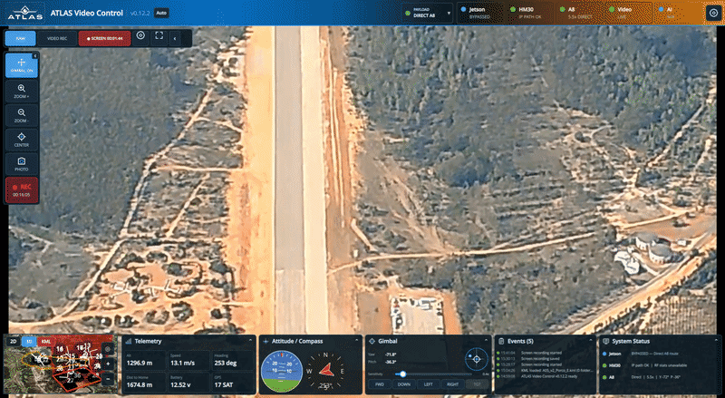
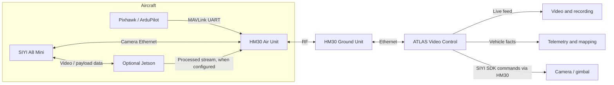

<h1 align="center">ATLAS Video Control</h1>

<p align="center">
  <a href="docs/atlas/media/atlas-demo-full.mp4" title="Watch the complete ATLAS Video Control demonstration">
    
  </a>
</p>

<p align="center"><em>Live SIYI A8 Mini video with ATLAS flight telemetry and operator controls.</em></p>

<p align="center">
  <a href="docs/atlas/media/atlas-demo-full.mp4"><strong>Watch the full 44-second demonstration</strong></a>
</p>

<p align="center">
  
  
  
</p>

**ATLAS Video Control** is a custom, **video-centric UAV ground station** built on [QGroundControl](https://github.com/mavlink/qgroundcontrol). It integrates SIYI camera and gimbal control, live video, MAVLink telemetry, operational mapping, local recording, and an optional onboard AI-processing architecture.

Unlike a conventional flight-planning-focused ground station, ATLAS prioritizes the **payload operator's workflow**: observe the live feed, steer the gimbal, capture evidence, view aircraft telemetry, and inspect operational airspace overlays. The underlying QGroundControl/MAVLink stack remains present; the application is **not** inherently receive-only or incapable of flight commands.

> **Project status:** v0.12.2 is the current validated development checkpoint, not a certified flight-safety release. Refer to [Safety and limitations](docs/atlas/SAFETY.md) before connecting to a live aircraft.

## At a glance

| Area | Current implementation |
| --- | --- |
| **Camera** | SIYI A8 Mini direct UDP control, gimbal, zoom, photo, camera recording, supported stream settings |
| **Video** | RTSP over HM30, GStreamer/QGroundControl decoding and local recording |
| **Screen recording** | Independent recording of the ATLAS application window |
| **Telemetry** | Pixhawk/ArduPilot MAVLink telemetry through the SIYI HM30 data link |
| **Maps** | Interactive 2D/3D mapping and KML overlays, with hierarchy, styling, and altitude/extrusion semantics |
| **Payload routing** | Operator-selected Direct A8 or Jetson mode; no automatic failover |
| **Jetson / AI** | TCP/JSON integration architecture and mock server; onboard hardware integration remains separate work |

## System architecture



The **Direct A8** route works without a Jetson. The **Jetson** route is an optional architecture for processed video, AI, tracking and payload status; its real-hardware behaviour must be validated separately from the supplied mock server.

### Development endpoints

| Service | Known working/default endpoint |
| --- | --- |
| SIYI A8 camera | `192.168.144.25` |
| SIYI camera/gimbal control | UDP `192.168.144.25:37260` |
| A8 RTSP main stream | `rtsp://192.168.144.25:8554/main.264` |
| HM30 Ground Unit | `192.168.144.12` |
| HM30 MAVLink data link | UDP port `19856` |
| Jetson development/mock control | `127.0.0.1:45900` (configurable) |

For the currently tested Pixhawk/HM30 UART connection, the operational **Datalink BAUD is 57600**. This is a setup-specific observed value, not a universal requirement for every aircraft.

## Features

**SIYI A8 Mini:** gimbal yaw/pitch commands, stop/center/presets, zoom, photo, camera recording, FOLLOW/LOCK/FPV mode, video-output selection, codec status and supported stream configuration. The public SIYI SDK's documented stream-settings packet does not expose a writable FPS field; ATLAS treats reported FPS as read-only.

**Three recording paths:** **A8 REC** controls recording on the camera; **VIDEO REC** records the incoming video stream locally; **SCREEN REC** captures the full ATLAS window independently of whether payload video is available. Screen settings include 20/30/60/120/144 requested FPS, native/1080p/720p resolution and selectable bitrates. Actual achieved screen-recording FPS depends on capture and encoding performance.

**Operational mapping:** native 2D/3D map interaction plus imported KML polygons, lines, points, hierarchy, visibility, colors, and altitude/extrusion information. KML layers are **visual aids only** and are not sent to the Pixhawk as geofences.

**Telemetry:** vehicle data such as altitude, ground speed, heading, battery, GPS and attitude are drawn from QGroundControl's vehicle model over MAVLink. The tested HM30 link can carry telemetry and video through the same ground-side Ethernet connection.

**Optional Jetson integration:** interfaces for RAW/AI/RAW+AI display, detection and tracking requests, model/settings control and system-health indicators. The repository contains a mock Jetson server for development without onboard hardware.

## Build and run

The ATLAS development environment uses **Qt 6.11.1**, CMake, Ninja and QGroundControl's GStreamer video stack. The following commands describe the validated local development toolchain layout; other machines may need different Qt paths and dependencies.

```bash
cd ~/ATLAS/ATLAS-QGroundControl

PATH="$HOME/Qt/Tools/CMake/bin:$PATH" \
  "$HOME/Qt/6.11.1/gcc_64/bin/qt-cmake" \
  -S . -B build -G Ninja -DCMAKE_BUILD_TYPE=Release

"$HOME/Qt/Tools/CMake/bin/cmake" --build build --parallel 2
./build/Release/ATLAS-QGroundControl
```

For dependencies, hardware setup and troubleshooting, see [Setup](docs/atlas/SETUP.md). Offline ATLAS checks are provided in `tools/atlas/`, including `verify_payload_bundle.py` and `verify_siyi_video_pipeline_v0122.py`. These checks **do not replace** compiling and testing on actual hardware.

## Repository structure

| Path | Responsibility |
| --- | --- |
| `custom/atlas/src/AtlasCustomPlugin.*` | ATLAS custom QGroundControl plugin and QML integration |
| `custom/atlas/src/AtlasPayloadRouter.*` | Manual Direct A8 / Jetson routing and QML-facing payload API |
| `custom/atlas/src/AtlasSiyiClient.*` | Native SIYI UDP camera/gimbal protocol |
| `custom/atlas/src/AtlasJetsonClient.*` | Jetson TCP/JSON control/status client |
| `custom/atlas/src/AtlasScreenRecorder.*` | Independent ATLAS-window recording |
| `custom/atlas/src/AtlasKmlManager.*` | KML parsing, layer hierarchy and styles |
| `custom/atlas/src/AtlasKmlWallGeometry.*` | KML 3D terrain-aware wall geometry |
| `custom/atlas/src/*.qml` | Operator Fly View, toolbar, panels and map overlays |
| `src/VideoManager/VideoReceiver/GStreamer/` | QGroundControl video-receiver code and SIYI-specific changes |
| `tools/atlas/` | Development mocks, installers and verification scripts |

## Documentation

| Guide | Contents |
| --- | --- |
| [Architecture](docs/atlas/ARCHITECTURE.md) | Hardware, software components, network protocols and data paths |
| [Setup](docs/atlas/SETUP.md) | Build environment, installation and device configuration |
| [Operation](docs/atlas/OPERATION.md) | Operator controls, modes, video, recording and maps |
| [Development](docs/atlas/DEVELOPMENT.md) | Source code organization, testing and Git workflow |
| [Safety](docs/atlas/SAFETY.md) | MAVLink command paths, KML semantics and operational limitations |
| [Changelog](docs/atlas/CHANGELOG.md) | ATLAS release history and known changes |

### Branch policy

- **`master`** — QGroundControl upstream reference; ATLAS features are not developed here.
- **`atlas-main`** — validated ATLAS baseline.
- **`feature/*`** — isolated feature, fix and documentation development.

The current v0.12.2 baseline is commit `3af7c625b`; the historical checkpoint branch is `feature/payload-mode-v1`. Documentation and later experiments are developed separately before promotion to `atlas-main`.

## Known limitations and safety

- **MAVLink is bidirectional:** hiding flight controls in the payload UI does **not** prevent QGroundControl from transmitting MAVLink messages or commands. A verified receive-only design requires separate technical and hardware controls.
- **KML is not geofencing:** the application does not enforce the boundaries shown on maps.
- **Routing is manual:** no automatic Direct A8 / Jetson failover is implemented.
- **Camera settings are SDK-limited:** undocumented A8 settings, including arbitrary FPS writes, are deliberately excluded.
- **Linux video rendering:** minor periodic judder is under investigation; future Qt6 renderer experiments are not included in the validated v0.12.2 baseline.
- **Jetson:** hardware AI integration should not be inferred from successful mock-server integration.

See [Safety](docs/atlas/SAFETY.md) for the required distinctions between interface controls, data links and flight-critical behaviour.

## Upstream and licensing

ATLAS Video Control is developed on top of [QGroundControl](https://github.com/mavlink/qgroundcontrol) and retains the upstream source structure where possible. Upstream project documentation is available at [docs.qgroundcontrol.com](https://docs.qgroundcontrol.com/).

See the repository's `LICENSE-APACHE`, `LICENSE-GPL` and upstream licensing notices for applicable terms.
