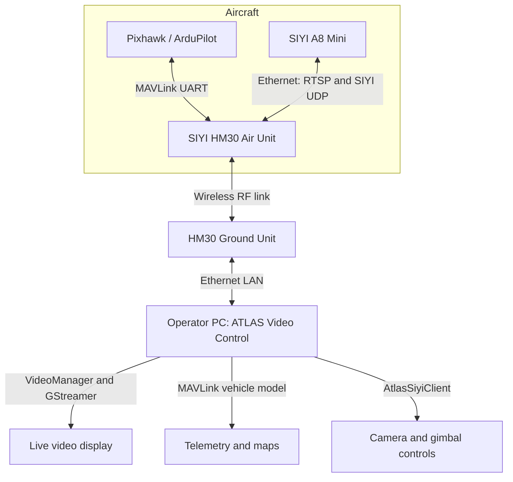
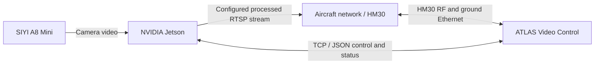
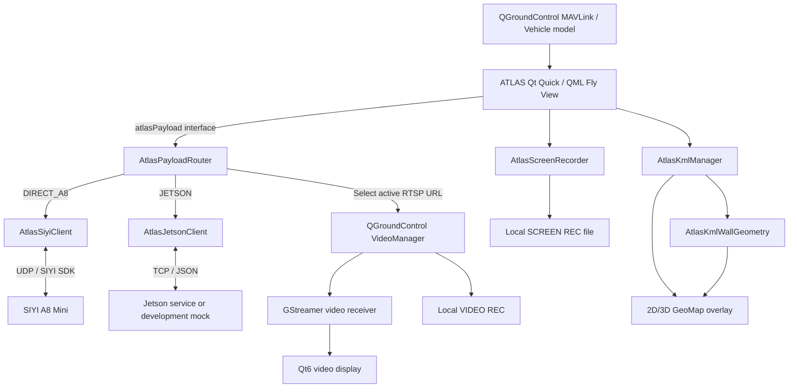

# System architecture

> **ATLAS Video Control v0.12.2** · Architecture of the current development baseline
> Source reference: [`atlas-main`](https://github.com/franciscomariquitos/ATLAS-QGroundControl/tree/atlas-main) / commit `3af7c625b`
> Scope: aircraft payload, video, telemetry, operator interface, recording and operational maps

ATLAS Video Control is a video-centric operator application built on QGroundControl. It extends QGroundControl with a SIYI payload-control stack, optional Jetson integration, three distinct recording functions, and operational KML overlays. It retains QGroundControl's MAVLink and video infrastructure.

**Architecture principle:** keep flight-controller telemetry, payload control and video conceptually separate. Sharing the same HM30 transport does **not** make these paths interchangeable, and hiding flight-control actions in the UI does **not** disable QGroundControl's underlying MAVLink transmit capability.

## 1. Deployment configurations

### 1.1 Direct A8 mode — current hardware setup



The ground computer connects to the **HM30 Ground Unit over Ethernet**. The HM30 transports more than one logical protocol over its radio link:

- A8 **RTSP video** delivered to QGroundControl's video receiver;
- SIYI **UDP control messages** sent to the A8 camera/gimbal;
- Pixhawk **MAVLink** messages transported by the HM30 data link.

The Jetson is **not required** for this configuration. The Pixhawk telemetry and the A8 video/control paths are logically independent, even though they share HM30 ground-side Ethernet and the RF transport.

**Important:** the MAVLink UART is shown as bidirectional because that is the capability of the present QGroundControl/HM30 arrangement. If the physical cable has been rewired to enforce one-way telemetry, the actual direction depends on that wiring; ATLAS does not detect or guarantee the isolation.

### 1.2 Jetson mode — software integration path, not a validated aircraft deployment



This second diagram represents the **intended Jetson processing architecture**, not a verified end-to-end network deployment. The Jetson service must provide an RTSP stream and the ATLAS TCP/JSON control protocol. The exact onboard switching, routing, IP addresses and physical wiring must be established and tested when the Jetson is installed. The MAVLink link is a separate logical data path; the simplified diagram does not specify its physical routing.

ATLAS already has the **Jetson client, interface and mock-server infrastructure**. A successful mock-server test must not be reported as proof of working onboard inference, tracking, processed streaming or RF metrics.

## 2. Interfaces and network endpoints

These values are defaults or observations from the current ATLAS/HM30 setup, not universal addresses for every UAV.

| Path | Direction | Transport | Current address / setting | Purpose |
| --- | --- | --- | --- | --- |
| A8 video | A8 → ATLAS, following RTSP session setup | RTSP over TCP | `rtsp://192.168.144.25:8554/main.264` | Live video |
| A8 payload control | ATLAS ↔ A8 | SIYI SDK over UDP | `192.168.144.25:37260` | Gimbal, zoom, photo, recording and camera settings |
| HM30 MAVLink data link | Pixhawk ↔ ATLAS unless physically restricted | UART + HM30 RF + UDP | Ground Unit `192.168.144.12`, UDP port `19856` | Aircraft telemetry and potentially outbound MAVLink |
| HM30 Ground ↔ PC | Both directions | Ethernet | `192.168.144.0/24` in the tested setup | Shared IP transport for video/control/data |
| Jetson control (development) | ATLAS ↔ Jetson | TCP/JSON | `127.0.0.1:45900` mock default; configurable | AI/payload requests, heartbeat and status |
| Jetson processed video | Jetson → ATLAS when configured | RTSP | Configurable; no validated deployment URL | Processed/AI video |
| KML import | Local file → ATLAS | Local filesystem | User-selected `.kml` | Operational map overlays |

During the successful HM30 telemetry test, the operator PC was assigned `192.168.144.122/24`; that IP was obtained on that occasion and must not be assumed to be permanently reserved.

The **HM30 Datalink Mode was UDP**, with **Datalink BAUD = 57600** matching the effective Pixhawk UART configuration. Setting 115200 on the HM30 had resulted in corrupted MAVLink bytes. This is a **measured configuration for this aircraft**, not a general recommendation to change every Pixhawk UART to 57600. The separate **AAT BAUD** setting is not part of this data-link fix.

## 3. ATLAS application architecture



### 3.1 Plugin and UI integration

The ATLAS custom build is declared in [`custom/atlas/CMakeLists.txt`](../../custom/atlas/CMakeLists.txt). [`AtlasCustomPlugin`](../../custom/atlas/src/AtlasCustomPlugin.cc) is built on QGroundControl's `QGCCorePlugin` and registers the ATLAS services with the QML engine:

| Exposed QML name | C++ object | Responsibility |
| --- | --- | --- |
| `atlasPayload` | `AtlasPayloadRouter` | Stable, operator-facing payload API and route selection |
| `atlasSiyiClient` | `AtlasSiyiClient` | Direct SIYI client, available for diagnostics |
| `atlasJetsonClient` | `AtlasJetsonClient` | Jetson client, available for diagnostics |
| `atlasScreenRecorder` | `AtlasScreenRecorder` | Independent ATLAS-window recording |
| `atlasKml` | `AtlasKmlManager` | KML data, hierarchy, visibility and map features |
| `atlasVideoManager` | QGroundControl `VideoManager` | Video-manager access |

The plugin also registers `AtlasKmlWallGeometry` as a QML type (`ATLAS.Kml 1.0`) and installs a QML URL interceptor. This resolves selected upstream `qrc:/qml/...` resources to corresponding `:/Custom/qml/...` ATLAS overrides when present, helping to isolate UI customization from QGroundControl's original components.

Primary ATLAS QML files:

- [`FlyView.qml`](../../custom/atlas/src/FlyView.qml): main Fly View, map composition and KML overlay integration;
- [`FlyViewCustomLayer.qml`](../../custom/atlas/src/FlyViewCustomLayer.qml): camera, video, tracking, recording and telemetry operator panels;
- [`FlyViewToolBar.qml`](../../custom/atlas/src/FlyViewToolBar.qml): ATLAS toolbar and route selection;
- [`FlyViewToolBarIndicators.qml`](../../custom/atlas/src/FlyViewToolBarIndicators.qml): compact connection and capability indicators;
- [`CustomMapItems.qml`](../../custom/atlas/src/CustomMapItems.qml): custom map items.

Some video receiver and toolbar files in upstream `src/` are also modified by ATLAS. This is **not** a plugin-only application; upstream updates to those paths require integration review.

### 3.2 Payload routing

[`AtlasPayloadRouter`](../../custom/atlas/src/AtlasPayloadRouter.cc) is the facade used by the operator UI. It delegates payload actions to either `AtlasSiyiClient` or `AtlasJetsonClient`, depending on the selected route. It also selects the corresponding RTSP URL in the existing QGroundControl video settings/manager.

- `DIRECT_A8`: native SIYI client and direct A8 RTSP;
- `JETSON`: TCP/JSON control and independently configured Jetson RTSP;
- selection is **manual and persisted in `QSettings`** under `ATLAS/Payload`;
- changing the route does **not** mean automatic failure recovery;
- no automatic Jetson discovery or automatic route failover is implemented.

The presence of Jetson-only controls in QML is an **interface capability**, not evidence that onboard AI is running. In Direct A8 mode, Jetson-only features are unavailable or hidden and the HM30 RF signal metrics are not synthesized.

### 3.3 Direct A8 control protocol

[`AtlasSiyiClient`](../../custom/atlas/src/AtlasSiyiClient.cc) uses Qt `QUdpSocket` and SIYI SDK framing, with CRC16/XMODEM checking, sequence handling, polling and a liveness/watchdog mechanism. Its responsibilities include gimbal rate/stop/center/presets, zoom, photographs, A8 camera recording, gimbal mode, output selection and camera codec configuration.

The documented SIYI codec requests are used as follows:

- `0x20`: read main/recording stream information, including reported codec, dimensions, bitrate and FPS;
- `0x21`: write supported codec/resolution/bitrate settings; no documented writable FPS field;
- the recording-stream codec is preserved because the documented SDK does not support changing it in that request.

Undocumented camera controls are **not assumed to work** simply because similar settings appear in SIYI's UniGCS application.

### 3.4 Jetson client protocol

[`AtlasJetsonClient`](../../custom/atlas/src/AtlasJetsonClient.cc) uses a TCP socket, JSON messages, connection monitoring and heartbeat logic. The interface defines fields and requests for AI state, stream selection, target/tracking data and system status. [`tools/atlas/mock_jetson_server.py`](../../tools/atlas/mock_jetson_server.py) supplies a development backend for integration testing.

The actual Jetson application, AI models, processed RTSP endpoint, device performance and HM30 metric acquisition must be implemented/configured and validated on the aircraft hardware independently of the mock.

## 4. Video pipeline and recording boundaries

### 4.1 Live RTSP

For the SIYI RTSP path, the v0.12.2 checkpoint aligns the receiver with selected SIYI-QGroundControl behaviours:

```text
A8 RTSP server
   → HM30 RF/IP network
   → GStreamer rtspsrc (TCP interleaved, latency 17 ms)
   → parsebin
   → standard decoder queue (not the prior two-buffer leaky queue)
   → decodebin3
   → QGroundControl Qt6 video output
   → ATLAS Fly View
```

The explicit RTSP timeout is 5 seconds, and the old UDP/TCP fallback and pre-decoder leaky-queue policy were removed from this branch's SIYI RTSP path. This is a **pipeline-compatibility adjustment**, not a claim that the modern Qt6 renderer is identical to SIYI's historical Qt5 `qmlglsink` implementation. Small periodic video judder remained under investigation in the tested Linux environment.

Core implementation files:

- [`GstSourceFactory.cc`](../../src/VideoManager/VideoReceiver/GStreamer/GstSourceFactory.cc)
- [`GstVideoReceiver.cc`](../../src/VideoManager/VideoReceiver/GStreamer/GstVideoReceiver.cc)

### 4.2 Three recording mechanisms

| Operator control | Processing location | What it captures | What it does not inherently capture |
| --- | --- | --- | --- |
| **A8 REC** | SIYI A8 Mini | Recording performed by the camera | The ATLAS panels and KML/UI overlays |
| **VIDEO REC** | Operator PC, QGroundControl VideoManager | Incoming active video stream | The full ATLAS application window |
| **SCREEN REC** | Operator PC, AtlasScreenRecorder | Rendered ATLAS application window, including whatever video/UI is visible | The camera's independent onboard recording quality |

`AtlasScreenRecorder` uses Qt Multimedia components with frames captured from the Qt Quick window (`QQuickWindow::grabWindow()`), and its software MPEG-4 encoding path is independent from the payload RTSP session. Supported selections include 20/30/60/120/144 **requested** FPS, native/1080p/720p output and configured bitrates. Effective achieved FPS can be lower than requested due to capture/encode limits.

These are separate mechanisms; starting one must not be assumed to start either of the others.

## 5. MAVLink integration and safety boundary

ATLAS uses QGroundControl's existing `LinkManager`/UDP and MAVLink/Vehicle infrastructure rather than a custom read-only MAVLink parser. The telemetry panels obtain facts from the active QGroundControl vehicle. Consequently, **the underlying link retains a MAVLink transmit path** even if the ATLAS payload UI does not expose flight controls.

A connected ATLAS can therefore potentially send messages such as heartbeats, requests and flight-related commands depending on QGroundControl behaviour and configuration. **Do not rely on the absence of visible flight buttons, changing `SYSID_THISMAV`, or changing a UDP port as a transmit-blocking mechanism.**

For safety-critical receive-only operation, the data path must be deliberately constrained and verified. A physically one-way UART arrangement can prevent HM30-to-Pixhawk commands at that UART (`Pixhawk TX → HM30 RX`, with the return `HM30 TX → Pixhawk RX` wire disconnected), provided the exact board pinout, common ground, telemetry reception and all other control paths are independently verified. A future software outbound-message filter is **not implemented in v0.12.2** and is not equivalent to physical isolation by itself.

The Mission Planner can use a separate flight-controller interface. Simultaneous applications must not contend for the same exclusive serial port or unintentionally bind the same local UDP endpoint. See [Safety](SAFETY.md) for operational restrictions.

## 6. Operational maps and KML

[`AtlasKmlManager`](../../custom/atlas/src/AtlasKmlManager.cc) reads local KML, constructs features and a document/folder/placemark visibility tree, and exposes polygons, lines and points to QML. The renderer supports KML styling (including shared styles), feature labels/icons, geometry and 2D/3D map visibility.

The altitude interpretation is significant:

| KML altitude mode | Interpretation |
| --- | --- |
| `clampToGround` | Geometry follows the ground surface |
| `relativeToGround` | Height above local terrain (AGL) |
| `absolute` | Height relative to the file's absolute vertical reference (AMSL in the current documented handling) |

[`AtlasKmlWallGeometry`](../../custom/atlas/src/AtlasKmlWallGeometry.cc) generates terrain-aware 3D wall geometry for extruded features. The file's `extrude`, fill and outline semantics must be respected; ATLAS must **not invent a 120 m height** for polygons that do not specify one. Display fidelity depends on the KML source and availability/accuracy of map/elevation tiles.

**Safety boundary:** imported KML features are visual overlays only. They are **not uploaded as Pixhawk geofences and are not a flight restriction enforcement mechanism**.

## 7. Operational state and validation

| Component | Present in v0.12.2 | Validation boundary |
| --- | --- | --- |
| Direct A8 UDP camera/gimbal client | Yes | Exercised with actual A8/HM30 setup; confirm status after every camera-setting change |
| RTSP through HM30 | Yes | Live video observed; residual Linux judder under investigation |
| MAVLink telemetry via HM30 | Yes | Working after matching HM30 UART baud to 57600 on the tested aircraft |
| VIDEO REC and SCREEN REC | Yes | Implemented and previously exercised; verify output and actual FPS for each configuration |
| 2D/3D KML import and walls | Yes | Structural verification exists; geographic/altitude fidelity requires checks against known KML references |
| Jetson TCP/JSON client and mock | Yes | Mock/integration support; not a completed real-Jetson deployment |
| Read-only MAVLink enforcement | **No** | Must not be inferred from the UI |
| Automatic payload failover | **No** | Route selection remains manual |
| Experimental Qt6 `qml6glsink` renderer | **No** | Planned as isolated development, not part of the stable checkpoint |

The project provides structural and protocol checks in [`tools/atlas/`](../../tools/atlas/). These do not substitute for an actual Qt build, physical hardware testing, encoder-output verification, field checks of map altitude and flight-safety review.

## 8. Related documents

- [Project overview](../../README.md)
- [Setup and configuration](SETUP.md)
- [Operator guide](OPERATION.md)
- [Developer guide](DEVELOPMENT.md)
- [Safety and limitations](SAFETY.md)
- [ATLAS changelog](CHANGELOG.md)

The `master` branch is reserved as the upstream QGroundControl reference; `atlas-main` is the validated ATLAS baseline; new work is developed in `feature/*` branches and promoted only after review and testing.
