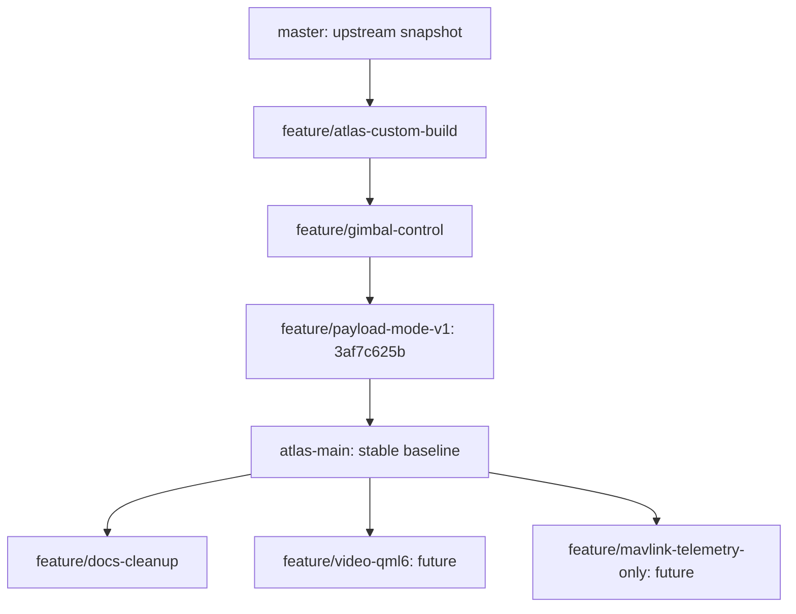

# Development guide

> **Project:** ATLAS Video Control · **Baseline:** v0.12.2
> **Audience:** C++/Qt/QML, GStreamer and payload-integration developers
> **Scope:** Source organization, workflows, tests, review, releases and upstream maintenance

ATLAS is a **custom QGroundControl build**, not an independent application built from scratch. Develop its payload capabilities without unnecessarily modifying upstream QGroundControl. The currently documented baseline is commit `3af7c625b` on `atlas-main`; the documentation branch is `feature/docs-cleanup`.

## 1. Branch model

| Branch | Purpose | Policy |
| --- | --- | --- |
| `master` | Reference snapshot of upstream QGroundControl | Do not add ordinary ATLAS changes |
| `atlas-main` | Last validated ATLAS integration | Merge reviewed, tested changes only |
| `feature/<topic>` | Isolated feature, bug fix or documentation change | Development and review happen here |
| `feature/payload-mode-v1` | Historical pre-reorganization ATLAS branch | Retain as a checkpoint; do not develop new features here |

This is a **repository policy**, not an assertion that `master` is continuously synchronized with upstream. Updating from upstream is a separate, deliberate maintenance task. Do **not** press GitHub **Sync fork** or merge upstream into `atlas-main` without inspecting compatibility and running tests.

The documented development progression is:



The future feature branches shown above are **examples**, not confirmation that they already exist. The initial creation of a branch does not copy or modify code: it creates a second reference to the same commit.

### Start a new feature

Use the repository's working directory:

```bash
cd ~/ATLAS/ATLAS-QGroundControl
git fetch origin
git switch atlas-main
git pull --ff-only origin atlas-main
git switch -c feature/<short-topic>
```

Replace `<short-topic>` with a descriptive name, for example `feature/video-qml6`. Do not type the angle brackets literally. `--ff-only` refuses a history-diverging pull rather than silently creating a merge.

### Before committing

```bash
git status --short
git diff --check
git diff --stat
git diff
```

After staging **specific** files:

```bash
git add path/to/changed-file
git diff --cached --check
git diff --cached --stat
git diff --cached
```

Use `git add -A` only when you have independently reviewed *every* modification and newly created file. Development artifacts, recordings, local credentials and temporary backups must not be included inadvertently.

### Commit and publish

```bash
git commit -m "docs(atlas): consolidate project documentation"
git push -u origin feature/<short-topic>
```

For later commits on a branch with upstream tracking, `git push` is sufficient. The `-u` option links the local and remote branch; it does not change the repository's default branch.

### Integrate into stable

Prefer a GitHub pull request with:

- **Base:** `atlas-main`
- **Compare:** your `feature/<topic>` branch
- a summary of changes, validation evidence and any known limitations

After review, merge into `atlas-main` using the project's chosen GitHub merge policy. Then verify locally:

```bash
git fetch origin
git switch atlas-main
git pull --ff-only origin atlas-main
git log -3 --oneline --decorate
```

Do not merge documentation into `master`. Change the repository default branch to `atlas-main` **only after** the documentation merge is complete and reviewed; this affects GitHub's landing page, not which local branch is checked out.

## 2. Development environment

The validated development machine uses Ubuntu/Linux, Qt **6.11.1**, CMake, Ninja and GStreamer. Local Qt paths may differ on other machines; do not present the documented paths as universal system dependencies. Full installation and network configuration live in [Setup](SETUP.md).

From the repository root:

```bash
PATH="$HOME/Qt/Tools/CMake/bin:$PATH" \
  "$HOME/Qt/6.11.1/gcc_64/bin/qt-cmake" \
  -S . -B build -G Ninja -DCMAKE_BUILD_TYPE=Release

"$HOME/Qt/Tools/CMake/bin/cmake" --build build --parallel 2
./build/Release/ATLAS-QGroundControl
```

Changing C++ sources, QML resource registrations or CMake files can require reconfiguration. Ordinary UI text changes do not normally require rebuilding the entire dependency tree.

**Important:** `tools/atlas/verify_payload_bundle.py` is a structural/offline verification script. A PASS from that script is not proof that Qt compiles, the A8 responds, MAVLink is isolated or the real Jetson AI system works.

## 3. ATLAS code ownership

Keep ATLAS-specific logic in `custom/atlas/` whenever feasible. A smaller upstream diff is easier to audit and carry forward.

| File/component | Responsibility |
| --- | --- |
| `custom/atlas/CMakeLists.txt` | Registers ATLAS C++ files, icons and QML overrides |
| `AtlasCustomPlugin.*` | Custom QGroundControl plugin; creates and exposes ATLAS services to QML |
| `AtlasPayloadRouter.*` | Stable UI-facing facade; manually selects Direct A8 or Jetson backend and active RTSP source |
| `AtlasSiyiClient.*` | SIYI A8 Mini UDP SDK framing, request/response and camera/gimbal commands |
| `AtlasJetsonClient.*` | Jetson TCP/JSON control and status client, heartbeat/reconnect behaviour |
| `AtlasScreenRecorder.*` | Independent recording of the rendered ATLAS window |
| `AtlasKmlManager.*` | Parses KML features, hierarchy, styling and visibility models |
| `AtlasKmlWallGeometry.*` | Qt Quick 3D geometry for terrain-aware extrusions |
| `FlyView.qml` | Fly View composition, map mode and operational KML visualization |
| `FlyViewCustomLayer.qml` | Main ATLAS control panels and interactions |
| `FlyViewToolBar.qml` / `FlyViewToolBarIndicators.qml` | Payload route, application status and toolbar UI |
| `CustomMapItems.qml` | Map annotations for target data provided by a backend |

The core video implementation also modifies:

```text
src/VideoManager/VideoReceiver/GStreamer/GstSourceFactory.cc
src/VideoManager/VideoReceiver/GStreamer/GstVideoReceiver.cc
```

These changes make the RTSP reception semantics closer to SIYI-QGroundControl (TCP transport, 17 ms latency, ordinary decoder queue, `decodebin3`). **Treat core modifications as higher-risk** when rebasing on a new QGroundControl version. Re-run the dedicated video checks and assess hardware behaviour, not only compilation.

### QML/C++ boundary

`AtlasCustomPlugin` exposes:

- `atlasPayload` — `AtlasPayloadRouter`, the primary UI API
- `atlasSiyiClient` / `atlasJetsonClient` — direct backend access for diagnostics
- `atlasScreenRecorder` — local window recording
- `atlasKml` — imported airspace/operational layers
- `atlasVideoManager` — underlying QGroundControl video manager

UI commands should generally pass through `atlasPayload`, **not directly through a concrete transport client**. This retains one route-aware API and prevents the UI from depending on the selected backend. The only switch supported in the current baseline is the operator's explicit route selection; no automatic fallback exists.

### Source-of-truth rules

1. Check actual C++/QML behaviour before adding a capability to documentation or UI.
2. Differentiate protocol *request sent*, *acknowledged*, and *observed hardware state*.
3. Distinguish real devices from mock responses, especially HM30 RF metrics and Jetson inference.
4. Do not synthesize unsupported SIYI command identifiers or writable FPS settings.
5. Preserve KML `absolute`, `relativeToGround`, `clampToGround`, styling and `extrude` semantics; no invented fallback zone height.
6. Treat a visually telemetry-only screen as distinct from a physically receive-only MAVLink connection.
7. Leave network endpoints configurable; hard-coded defaults document the tested setup, not all installations.

## 4. Test layers

Use the cheapest checks first, then build, then bench-test the relevant real hardware.

| Level | Command / action | What it establishes | What it cannot establish |
| --- | --- | --- | --- |
| Structural | `python3 tools/atlas/verify_payload_bundle.py` | Files, API markers and selected regression invariants | Runtime operation, flight safety |
| RTSP patch | `python3 tools/atlas/verify_siyi_video_pipeline_v0122.py` | Expected GStreamer source/queue configuration | RF stability, rendered frame quality |
| C++/QML | Qt/CMake configure and build | Source compilation/linking | Correct A8/Jetson behaviour |
| Simulated A8 | `python3 tools/atlas/mock_siyi_camera.py` | Basic SIYI client integration | Physical gimbal/camera compatibility |
| Simulated Jetson | `python3 tools/atlas/mock_jetson_server.py` | TCP/JSON protocol and UI state | Real detection, depth, SAHI or onboard performance |
| Hardware bench | Confirm Direct A8/RTSP/recording/HM30 telemetry with propellers removed | Actual connected-device behaviour | Airborne reliability or a receive-only MAVLink guarantee |

Do not run `tools/atlas/apply_siyi_video_pipeline_v0122.py` as a routine verification step. **It modifies source files.** On the current checkpoint the video changes are already committed. The versioned installation script is useful for historical bundle application, not for every incremental build.

### Regression checklist

- Direct A8 RTSP plays with the intended decoder settings and recovers from interrupted links.
- Gimbal stop, center, rate and zoom behave appropriately under hardware testing.
- Camera REC, VIDEO REC and SCREEN REC start and stop independently; output files are readable.
- Screen recording continues when RTSP goes away, and failure is reported rather than falsely marked saved.
- Importing real KML preserves style, layer hierarchy, altitude modes and 3D extrusion.
- Switching Direct A8 / Jetson changes the selected route without an unintended automatic fallback.
- Connected MAVLink is evaluated separately from the video/SIYI control path.
- No command-safety claim is made without a hardware and protocol audit.

## 5. Maintaining upstream QGroundControl

The project is forked from [mavlink/qgroundcontrol](https://github.com/mavlink/qgroundcontrol). Upstream's `CHANGELOG.md`, `AGENTS.md`, source conventions and licensing should remain intact wherever possible. ATLAS's separate release notes are in [ATLAS Changelog](CHANGELOG.md).

For an upstream update, use a **dedicated maintenance branch**. Review changes to the Qt version, QML resource system, MAVLink command flow, video/decoder pipeline and GeoMap geometry. Do not automatically resolve custom-source conflicts by accepting the upstream version; that may remove operational ATLAS features.

Read the repository's [CODING_STYLE.md](../../CODING_STYLE.md), [AGENTS.md](../../AGENTS.md), and relevant upstream CONTRIBUTING guidance before editing C++ or QML.

## 6. Versioning, checkpoints and rollbacks

The historical `feature/payload-mode-v1` branch contains the v0.12.2 checkpoint, despite its legacy name. Early `v1.x` labels predate the later `v0.7` pre-deployment reset. See [ATLAS Changelog](CHANGELOG.md).

The baseline commit is:

```text
3af7c625b  checkpoint: ATLAS payload v0.12.2 SIYI video full
```

A separate `atlas-v0.12.2-siyi-video-full` tag was used as a rollback reference; verify that the tag exists and points to the intended commit before relying on it:

```bash
git tag -l 'atlas-v0.12.2*'
git show --no-patch --decorate atlas-v0.12.2-siyi-video-full
```

**Never use `git reset --hard` or force-push to implement normal rollbacks on a shared branch.** To examine the old checkpoint without changing a current working branch:

```bash
git switch --detach 3af7c625b
```

After inspection, return to a named branch with `git switch atlas-main`. Commit/tag names identify software states, not hardware certification.

## 7. Documentation maintenance

ATLAS has one public landing page at [`README.md`](../../README.md) and six scoped documents under `docs/atlas/`:

- [Architecture](ARCHITECTURE.md) — hardware, network and software paths
- [Setup](SETUP.md) — development environment and wiring/network configuration
- [Operation](OPERATION.md) — operator instructions
- [Development](DEVELOPMENT.md) — source ownership and contribution workflow
- [Safety](SAFETY.md) — failure modes and boundaries of control
- [Changelog](CHANGELOG.md) — consolidated ATLAS revision history

The historical `README_PAYLOAD_*.txt` and `README_SIYI_VIDEO_PIPELINE.txt` were input materials for this consolidation. After the documentation is reviewed, remove them from the **current tree** using `git rm`; their original bytes remain in the old Git commit. Do not delete the upstream `CHANGELOG.md`, `AGENTS.md`, QGroundControl README references or unrelated developer documentation.

Use `git diff --check`, review changed file names, validate local Markdown links and embedded media sizes, then commit the whole documentation migration as one coherent change.

---

**Related:** [Project README](../../README.md) · [Architecture](ARCHITECTURE.md) · [Setup](SETUP.md) · [Operation](OPERATION.md) · [Safety](SAFETY.md) · [ATLAS Changelog](CHANGELOG.md)
