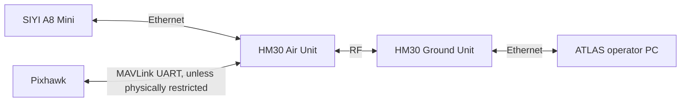

# Setup and configuration

> **ATLAS Video Control v0.12.2** · Development, network and hardware setup
> Reference: [`atlas-main`](https://github.com/franciscomariquitos/ATLAS-QGroundControl/tree/atlas-main), commit [`3af7c625b`](https://github.com/franciscomariquitos/ATLAS-QGroundControl/commit/3af7c625b517bf3e192c5a8d3abfc80e33b6fbde)
> Scope: the tested Linux development machine and its SIYI A8 Mini / HM30 / Pixhawk configuration

This guide explains how to obtain, build and launch ATLAS, connect its supported hardware and isolate common faults. The commands describe the **known development setup**; they are not universal defaults for every aircraft or operating system.

**Before connecting to a flight controller:** read [Safety and limitations](SAFETY.md). The underlying QGroundControl MAVLink link can transmit commands. An operator interface that displays telemetry only is **not** a receive-only communications barrier.

## 1. Prerequisites

### 1.1 Development environment

The checkpoint was developed and built in the following environment:

| Component | Known development setup | Notes |
| --- | --- | --- |
| Operating system | Ubuntu Linux, development laptop | Commands below use Bash; other platforms are not covered here |
| Qt | **6.11.1**, GCC desktop kit | Installed under `~/Qt/6.11.1/gcc_64/` |
| CMake | Qt-distributed CMake | `~/Qt/Tools/CMake/bin/cmake` |
| Build generator | Ninja | Used with `-G Ninja` |
| Build configuration | Release | `-DCMAKE_BUILD_TYPE=Release` |
| Video | GStreamer | Installed plugins must support the codec emitted by the A8 |
| Python | Python 3 | Needed for ATLAS mock/verification scripts |
| Hardware | SIYI A8 Mini + HM30 + Pixhawk | Jetson is optional for Direct A8 mode |

For a **fresh workstation**, first install QGroundControl's Linux prerequisites and Qt modules using the upstream [QGroundControl build instructions](https://dev.qgroundcontrol.com/en/getting_started/). This ATLAS guide assumes the listed Qt toolchain is already installed; it deliberately does not invent an unverified `apt install` package set or claim the code has been tested against other Qt versions.

Check locally installed commands:

```bash
"$HOME/Qt/6.11.1/gcc_64/bin/qt-cmake" --version
"$HOME/Qt/Tools/CMake/bin/cmake" --version
ninja --version
python3 --version
gst-launch-1.0 --version
```

If a command does not exist, resolve that dependency before proceeding. Do not change the global GStreamer installation merely to experiment with an alternative video renderer.

### 1.2 Repository and branches

| Branch | Purpose |
| --- | --- |
| `master` | Upstream QGroundControl reference; no routine ATLAS feature development |
| `atlas-main` | Current validated ATLAS baseline |
| `feature/*` | Independent development, verification and documentation |

For a new working copy of the current ATLAS baseline:

```bash
git clone --branch atlas-main \
  https://github.com/franciscomariquitos/ATLAS-QGroundControl.git
cd ATLAS-QGroundControl
git submodule update --init --recursive
```

For the existing development checkout:

```bash
cd ~/ATLAS/ATLAS-QGroundControl
git status
git branch --show-current
```

**Do not switch branches with uncommitted work you want to preserve.** In particular, documentation currently being prepared on `feature/docs-cleanup` must remain there until reviewed and integrated. `git fetch origin` updates remote references without replacing the working files.

## 2. Build and launch

### 2.1 Configure CMake

From the existing ATLAS project directory:

```bash
cd ~/ATLAS/ATLAS-QGroundControl

PATH="$HOME/Qt/Tools/CMake/bin:$PATH" \
  "$HOME/Qt/6.11.1/gcc_64/bin/qt-cmake" \
  -S . -B build -G Ninja -DCMAKE_BUILD_TYPE=Release
```

`-S .` selects the project source tree; `-B build` places generated build files and outputs in `build/`; `-G Ninja` uses Ninja; the final argument selects a Release build. The ATLAS custom build is assembled through `custom/atlas/CMakeLists.txt` and its custom overrides.

Run configuration again when C++ source registration, Qt resources, CMake options or the toolchain change. For ordinary incremental source edits, a rebuild is normally sufficient.

### 2.2 Build

```bash
"$HOME/Qt/Tools/CMake/bin/cmake" --build build --parallel 2
```

`--parallel 2` limits concurrent build jobs on the tested laptop; increase only if the machine has enough free memory. The first build can take substantially longer than subsequent incremental builds.

### 2.3 Launch

```bash
./build/Release/ATLAS-QGroundControl
```

Run it from a terminal during commissioning so GStreamer, Qt and ATLAS diagnostic messages remain visible.

### 2.4 If Qt reports stale AUTOMOC metadata

A previous v0.12.x update exposed stale generated ATLAS `moc` files. If errors refer to properties or signals that no longer exist in the current ATLAS headers, remove **only the generated ATLAS AUTOGEN directories** and then reconfigure:

```bash
rm -rf \
  build/ATLAS-QGroundControl_autogen \
  build/CMakeFiles/ATLAS-QGroundControl_autogen.dir

PATH="$HOME/Qt/Tools/CMake/bin:$PATH" \
  "$HOME/Qt/6.11.1/gcc_64/bin/qt-cmake" \
  -S . -B build -G Ninja -DCMAKE_BUILD_TYPE=Release

"$HOME/Qt/Tools/CMake/bin/cmake" --build build --parallel 2
```

This is a targeted cleanup, **not** a recommendation to delete the entire build tree. If errors persist, retain the complete first compiler error and investigate it before changing dependencies.

## 3. Network topology: Direct A8



**Direct A8 mode does not require a Jetson.** Video, SIYI camera commands and MAVLink use separate protocols even though they may cross the same HM30 radio and Ethernet network.

### 3.1 Observed addresses and ports

| Device / service | Tested or default setting | Usage |
| --- | --- | --- |
| HM30 Ground Unit | `192.168.144.12` | HM30 network peer |
| A8 Mini | `192.168.144.25` | Camera network endpoint |
| A8 SDK control | UDP `192.168.144.25:37260` | Gimbal and camera commands |
| A8 live video | `rtsp://192.168.144.25:8554/main.264` | Main RTSP stream |
| HM30 MAVLink | UDP port `19856` | Pixhawk telemetry link |
| PC Ethernet address | Example: `192.168.144.122/24` | Address observed via DHCP, **not a guaranteed static address** |

The `.264` suffix in the RTSP URL **does not guarantee an H.264 codec**. The tested A8 main stream used H.265 at the time of investigation; verify what the camera actually reports.

### 3.2 Check the Ethernet interface

Plug the HM30 Ground Unit into the laptop's Ethernet connection, then run:

```bash
ip -br addr
ip route get 192.168.144.25
```

On the tested Linux laptop the wired interface was named `eno1`; your system may use another name. The route to the A8 should use the **wired HM30 network**, not the Wi-Fi default route.

Test reachability:

```bash
ping -c 4 192.168.144.12
ping -c 4 192.168.144.25
```

Interpret carefully:

- The Ground Unit responding but the A8 not responding suggests an A8-side connectivity, power, configuration or Air Unit Ethernet issue; it does **not** conclusively identify a cable fault.
- Ping alone does not prove that UDP camera control or RTSP video works; some devices can also block ICMP.
- A visible HM30 RF/link indication does not, by itself, prove end-to-end A8 IP reachability.

If the link stops working immediately after a HM30 radio-mode change, restore the **last known working wireless mode while on the ground**, confirm Air/Ground pairing and restart the units as required. Do not experiment with RF mode changes during flight.

### 3.3 Configure ATLAS for Direct A8

In the ATLAS toolbar, open **PAYLOAD**, manually select **DIRECT A8**, and confirm:

```text
A8 control IP:   192.168.144.25
A8 control port: 37260
A8 RTSP URL:    rtsp://192.168.144.25:8554/main.264
```

The route and individual endpoint profiles are stored through `QSettings` under `ATLAS/Payload`. The selection is **manual** and persists; ATLAS does not automatically switch between Direct A8 and Jetson when a device disconnects.

Validate **video first**, then SIYI camera connection, then gimbal, zoom, photo and camera recording individually. Only do actuator/camera tests in a safe, stationary ground setup.

## 4. Verify video independently of ATLAS

Checking the source outside the application helps separate camera/network faults from Qt rendering problems.

### 4.1 Inspect decoder support

```bash
gst-inspect-1.0 rtspsrc
gst-inspect-1.0 avdec_h265
gst-inspect-1.0 avdec_h264
```

If any plugin is missing, install the appropriate GStreamer component from the operating system's supported packages before attempting that pipeline.

### 4.2 Test the known H.265 stream

The following pipeline was used successfully during the A8/HM30 investigation:

```bash
gst-launch-1.0 \
  rtspsrc location=rtsp://192.168.144.25:8554/main.264 protocols=tcp latency=17 \
  ! rtph265depay ! h265parse ! avdec_h265 ! videoconvert \
  ! autovideosink sync=false
```

This is a **diagnostic** and is not identical to the full ATLAS Qt6 renderer. If the camera reports H.264 instead, select the corresponding H.264 depayloader, parser and decoder.

If standalone GStreamer works but ATLAS displays black frames, freezes or corruption, investigate the **application video decoder/render path** rather than assuming the HM30 radio is disconnected.

### 4.3 Known-good Linux video troubleshooting baseline

For the investigated Linux machine and SIYI v0.12.2 video pipeline, the stable comparison used:

| Setting | Test value |
| --- | --- |
| RTSP transport | TCP interleaved (set by the SIYI-specific source pipeline) |
| Force video decoder priority | **Force software decoder** |
| Force CPU video path | **OFF** |
| Low Latency Mode | **OFF/default** |
| PRIME GPU offload overrides | Not enabled for this comparison |

Restart ATLAS after changing settings marked as requiring a reboot in QGroundControl. This configuration reduced corruption on the tested laptop, but **did not eliminate all small periodic video judder**. Do not describe it as a universally optimal pipeline or replace system graphics drivers based solely on this guide.

The RTSP-specific changes are described in [Architecture and interfaces](ARCHITECTURE.md). Historical release notes remain recoverable from Git commit `3af7c625b` after the old `README_PAYLOAD_*.txt` files are removed from the current tree. The implementation resides in QGroundControl's `GstSourceFactory.cc` and `GstVideoReceiver.cc`.

## 5. Configure HM30 MAVLink telemetry

The working data path is:

```text
Pixhawk MAVLink UART
  → HM30 Air Unit
  → HM30 RF link
  → HM30 Ground Unit
  → Ethernet
  → ATLAS QGroundControl UDP link
  → QGroundControl active Vehicle / telemetry display
```

For the tested aircraft:

| HM30 setting | Working value |
| --- | --- |
| Datalink Mode | **UDP** |
| Datalink BAUD | **57600** |
| Ground Unit IP | `192.168.144.12` |
| Data-link UDP port | `19856` |

A previous HM30 Datalink BAUD value of `115200` produced invalid UART bytes. Changing it to `57600` restored MAVLink telemetry. **This value is specific to the connected Pixhawk UART.** Another aircraft must match its own configured serial-link baud. The unrelated HM30 **AAT BAUD** option is not part of this fix.

### 5.1 Add or inspect the UDP communication link

In QGroundControl's **Application Settings → Comm Links**, configure a UDP link with the appropriate local listening port and the HM30 peer at `192.168.144.12:19856`, following the link configuration controls exposed by your build. The tested link used local UDP port `19856` and communicated with the HM30 Ground Unit on the same port.

Do not claim that simply opening this link enforces receive-only mode. QGroundControl can transmit MAVLink messages over it.

### 5.2 Inspect incoming UDP traffic

If telemetry is missing, check whether the network actually carries data:

```bash
sudo tcpdump -ni eno1 'udp port 19856'
```

Replace `eno1` with the interface name found using `ip -br addr`. On the investigated setup, traffic became visible **after ATLAS connected to the HM30 UDP link**, so no initial packets with the GCS disconnected did not prove the radio was broken.

A more detailed diagnostic, for bench use only, is:

```bash
sudo tcpdump -ni eno1 -s 0 -XX \
  'host 192.168.144.12 and udp port 19856' -c 20
```

This displays bytes on the wire; it does not decode MAVLink. A valid MAVLink frame commonly begins with `0xFD` (MAVLink 2) or `0xFE` (MAVLink 1). Repeated nonsensical data may indicate UART framing/baud problems, but inspect the full stream rather than diagnosing from a single byte.

### 5.3 Mission Planner coexistence

Mission Planner can communicate over a **separate** USB, radio or UART route while ATLAS receives telemetry through HM30. A separate transport does not by itself prohibit either GCS from issuing flight commands. Do not try to make Mission Planner and ATLAS bind the same exclusive local serial interface or UDP socket without explicitly configuring a suitable forwarding design.

### 5.4 Telemetry-only is not enabled by default

**Critical:** the ATLAS v0.12.2 QGroundControl MAVLink transport remains bidirectional. Removing flight-control buttons from the ATLAS UI does not remove the packet-transmission implementation. Changing `SYSID_THISMAV` does not provide command isolation either.

A physically one-way UART (`Pixhawk TX → HM30 RX`, **no** return connection from HM30 TX to Pixhawk RX) can isolate that UART's command path, **provided the wiring/pinout, shared ground, telemetry continuity and other control links are reviewed and verified on the ground**. No software outbound MAVLink safety filter is implemented in this checkpoint. Consult [Safety and limitations](SAFETY.md) before any use involving a live flight controller.

## 6. Optional Jetson development mode

The **Direct A8** configuration above does not need Jetson. ATLAS contains a separate Jetson integration interface intended for onboard AI/processed video.

To test the TCP/JSON protocol without aircraft hardware, start the supplied development server in a separate terminal:

```bash
cd ~/ATLAS/ATLAS-QGroundControl
python3 tools/atlas/mock_jetson_server.py
```

In ATLAS, select **JETSON** manually and configure its development control endpoint:

```text
Jetson control host: 127.0.0.1
Jetson control port: 45900
Jetson RTSP URL:     separately configured; no assumed hardware URL
```

The mock simulates status and commands for UI testing; it does **not** establish real AI inference, gimbal control via Jetson, RF signal measurements or a working processed-video service. For a deployed Jetson, document the real IP addressing, service startup, RTSP route and end-to-end behaviour only after hardware validation.

## 7. ATLAS verification scripts

From the project root:

```bash
python3 tools/atlas/verify_payload_bundle.py
python3 tools/atlas/verify_siyi_video_pipeline_v0122.py
```

The first script performs structural checks for the ATLAS sources, SIYI protocol vectors and critical application invariants. The second checks the expected SIYI-style GStreamer source/decoder configuration in the current core files.

These tools are **not** a substitute for a successful Qt compilation, correct physical wiring, real media recording, or tests on the actual HM30/A8/Pixhawk equipment.

**Do not rerun** `install_v0_12_2_siyi_video_full.sh` as a routine verification step on an already-configured checkout. It includes a source patch, generation cleanup and rebuild. Use it only when deliberately installing that particular historical bundle into the intended source state.

## 8. Troubleshooting reference

| Symptom | First check | Next isolation step |
| --- | --- | --- |
| `qt-cmake` not found | Qt 6.11.1 path and installed desktop kit | Check CMake toolchain and upstream prerequisites |
| C++/Qt errors after an ATLAS update | Read **first** actual compiler error | Targeted AUTOGEN cleanup for stale `moc` output |
| No HM30 network address | Wired interface and DHCP/IP configuration | Check cable, Ground Unit and route to `192.168.144.12` |
| HM30 radio linked, A8 unreachable | Ping `.12` and `.25` independently | Verify A8 power, Air Unit LAN, last known RF mode |
| A8 reachable, no live video | RTSP URL and actual codec | Try standalone GStreamer TCP pipeline |
| Standalone GStreamer OK, ATLAS video broken | Decoder selection and Qt/GStreamer console messages | Compare software-decoder baseline; isolate renderer |
| Video mosaics or freezes on Linux | Packet/stream errors versus GPU buffer mapping | Check software decoding; avoid changing multiple settings at once |
| No MAVLink telemetry | UDP link, port 19856, HM30 Datalink Mode | Inspect incoming UDP and the **actual UART baud** |
| A8 controls work, Jetson controls unavailable | Selected payload mode | Direct A8 intentionally has no Jetson AI backend |
| Screen recording does not start | Recorder error, output directory and disk space | Verify software encoder and requested effective FPS |
| KML altitude looks wrong | Original KML altitude mode and coordinates | Compare rendered feature to source KML and elevation data |

Change **one variable at a time**, record its previous value and confirm recovery before testing another. Avoid altering the working radio settings, UART baud, graphics drivers or decoder path immediately before a flight.

## 9. Commissioning checklist

For a **bench-only** validation, with the aircraft secured and no flight-critical actuation permitted:

- [ ] Correct Git branch and expected ATLAS v0.12.2 source selected
- [ ] Qt configuration and Release build succeed
- [ ] HM30 Ground Ethernet interface and route verified
- [ ] A8 reachability and RTSP video verified
- [ ] Direct A8 selected manually with confirmed SIYI endpoint
- [ ] Gimbal/zoom/photo/recording checked individually and safely
- [ ] MAVLink datalink baud matches the Pixhawk UART configuration
- [ ] Telemetry reception verified and any transmit-safety constraint checked separately
- [ ] VIDEO REC and SCREEN REC produce playable, correctly timed files
- [ ] KML layers, visibility, altitude modes and 2D/3D behaviour reviewed
- [ ] No untested settings or automatic failover assumed

Passing this checklist **does not certify the system for flight**. Flight readiness depends on independent avionics, radio-link, operational and safety procedures.

## 10. Related documentation

- [Project overview](../../README.md)
- [Architecture and interfaces](ARCHITECTURE.md)
- [Operator guide](OPERATION.md)
- [Developer workflow](DEVELOPMENT.md)
- [Safety and limitations](SAFETY.md)
- [ATLAS changelog](CHANGELOG.md)

For broader QGroundControl platform build instructions, use the [upstream developer guide](https://dev.qgroundcontrol.com/en/getting_started/).
