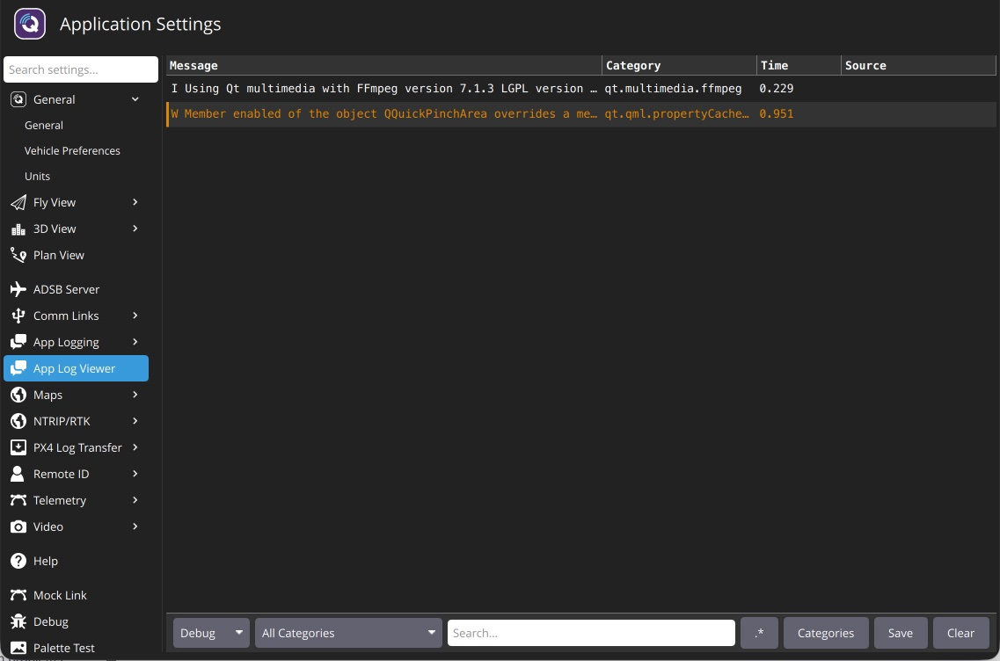

# Console Logging

The _App Log Viewer_ can be a helpful tool for diagnosing _QGroundControl_ problems. It can be found in **Application Settings > App Log Viewer**.



Click the **Categories** button to enable/disable the logging categories displayed by _QGroundControl_.

## Common Logging Categories

The most commonly used logging categories are listed below.

| Category(s)                                                                                                             | Description                                                                                    |
| ----------------------------------------------------------------------------------------------------------------------- | ---------------------------------------------------------------------------------------------- |
| `Comms.LinkManager`, `Vehicle.MultiVehicleManager`                                                                      | Debug connection problems.                                                                     |
| `Comms.LinkManager:verbose`                                                                                             | Debug serial ports not being detected. Very noisy continuous output of available serial ports. |
| `VehicleSetup.FirmwareUpgrade`                                                                                          | Debug firmware flash issues.                                                                   |
| `FactSystem.ParameterManager`                                                                                           | Debug parameter load problems.                                                                 |
| `FactSystem.ParameterManager:debugCacheFailure`                                                                         | Debug parameter cache crc misses.                                                              |
| `PlanManager.PlanManager`, `PlanManager.MissionManager`, `PlanManager.GeoFenceManager`, `PlanManager.RallyPointManager` | Debug Plan upload/download issues.                                                             |
| `AutoPilotPlugins.RadioComponentController`                                                                             | Debug Radio calibration issues.                                                                |

## Logging from the Command Line

An alternate mechanism for logging is using the `--logging` command line option. This is handy if you are trying to get logs from a situation where _QGroundControl_ crashes.

Two options work together:

- `--logging:full` (or `--logging:<comma-separated categories>`) enables the logging categories.
- `--log-output` writes the log messages to stderr (the terminal on macOS/Linux). Without it, messages are only visible in the _App Log Viewer_ and the **AppLog.log** file in the application log directory.

How you do this and where the traces are output vary by OS:

- Windows

  - Open a command prompt and run _QGroundControl_ from its install location (the installer default is shown below). Because _QGroundControl_ is a GUI application it has no console window, so stderr isn't displayed — redirect it to a file to capture it:

    ```sh
    cd "%ProgramFiles%\QGroundControl\bin"
    QGroundControl --logging:full --log-output > "%USERPROFILE%\qgc_log.txt" 2>&1
    ```

- macOS

  - You must run _QGroundControl_ from Terminal. The Terminal app is located in **Applications/Utilities**. Once Terminal is open paste the following into it:

    ```sh
    cd /Applications/QGroundControl.app/Contents/MacOS
    ./QGroundControl --logging:full --log-output
    ```

  - Log traces will output to the Terminal window.

- Linux

  - Run the AppImage from a terminal:

    ```sh
    ./QGroundControl-<arch>.AppImage --logging:full --log-output
    ```

  - Log traces will output to the shell you are running from.

## Android USB Serial Logging

On Android, _QGroundControl_ talks to USB serial devices (flight controllers, telemetry radios, GPS) through a Java layer and a C++ layer. Three logs show what this code is doing on a device, whether you are developing it or debugging a link in the field. All three go to the Android system log, which you read from a computer with [`adb`](https://developer.android.com/tools/adb).

### Device and Port Events

The Java layer reports USB attach and detach events, USB permission, and ports being opened under log tags that start with `QGCUsbSerial`, most of it under `QGCUsbSerialDevices` and `QGCUsbSerialPort`. This log is always on. To view it:

```sh
adb logcat -s QGCUsbSerialDevices QGCUsbSerialPort QGCUsbSerialReader QGCUsbSerialWriter QGCUsbSerialManager QGCUsbSerialAndroidHost QGCUsbSerialPortName
```

Example messages (the `I/O stopped` line is what an unplug looks like; one that interrupts a write also logs `Write failed on port 1`):

```text
QGCUsbSerialDevices: Added driver for /dev/bus/usb/001/014
QGCUsbSerialDevices: Opened /dev/bus/usb/001/014 as port 1
QGCUsbSerialAndroidHost: android.hardware.usb.action.USB_DEVICE_DETACHED: /dev/bus/usb/001/014
QGCUsbSerialPort: I/O stopped for port 1: java.io.IOException: Queueing USB request failed
```

### Byte-Level Trace

The Java layer can also trace the bytes of each transfer on a port. The trace is off by default. To turn it on, without rebuilding or restarting the app, and watch it:

```sh
adb shell setprop log.tag.QGCSerial VERBOSE
adb logcat -s QGCSerial
```

Each transfer is one line showing the port ID, direction, byte count, and up to the first 32 bytes in hex, with `...` after them when the transfer was longer:

```text
port 1 TX 21: FD 09 00 00 28 FF BE 00 00 00 00 00 00 00 06 08 C0 04 03 21 68
port 1 RX 4: FB BE 00 00
```

The port ID is the number in the `Opened ... as port N` message of the [device and port events](#device-and-port-events). Port setting changes are traced too:

```text
port 1 parameters: 57600 baud, 8 data bits, stop bits 1, parity 0
```

A `TX` line shows a whole write. If the app discards its output before all of it is sent, a line follows that says how much was sent:

```text
port 1 TX discarded after 1024 of 2500 bytes
```

If the app cannot keep up with the input of a port whose read buffer is limited, such as a GPS, the port stops reading the device until the app has room again, and the input waits in the adapter meanwhile. The trace marks the start and the end of such a pause:

```text
port 1 RX paused
port 1 RX resumed
```

To turn the trace off again, set the property to an empty value (a reboot also clears it):

```sh
adb shell setprop log.tag.QGCSerial '""'
```

### C++ Logging Categories

The C++ layer logs to the categories `Android.AndroidSerial`, `Android.AndroidSerialPort`, and `Android.AndroidSerialPortInfo`. Warnings always appear; debug output must be enabled, like any other logging category (see the [start of this page](#console-logging)). A debug build can also enable it for one run: launch the app with the [`--logging` option](#logging-from-the-command-line), which on Android is passed as an intent extra. A release build, which the published daily and stable builds are, ignores that extra:

```sh
adb shell am start -n org.mavlink.qgroundcontrol/.QGCActivity -e applicationArguments '"--logging:Android.AndroidSerial,Android.AndroidSerialPort"'
```

The lines appear in the Android system log under the app's own tag, which is `QGroundControl_Daily` for a daily build (`adb logcat -s QGroundControl_Daily`). They end with the category and function:

```text
Opening "/dev/bus/usb/001/014" - Android.AndroidSerialPort - (QSerialPortPrivate::open:38)
USB serial devices changed - Android.AndroidSerial - (AndroidSerial::jniDevicesChanged:373)
```
