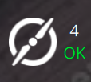
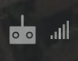
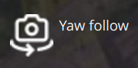
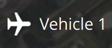
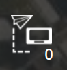

# 飞行视图工具栏

## 视图

工具栏左边的“Q”图标允许您在其他顶级视图中选择：

- **[Plan Flight](../plan_view/plan_view.md)：** 用于创建任务、地理栅栏和集结点
- **分析工具：** 用于日志下载、地理标记图像或查看遥测等事项的一组工具。
- **车辆配置：** 新车初始配置的各种选项。
- **应用程序设置：** QGroundControl应用程序本身的设置。

When a newer stable version of QGroundControl is available, a blue update badge is shown at the top right of the "Q" icon, and the views dropdown shows an **Update** button which opens the download page. A message about the new version is shown once per new version. The check only runs in stable builds.

## 工具栏指示器

Next are multiple toolbar indicators for vehicle status. 每个工具栏指示器的下拉功能提供了关于状态的更多细节。您也可以展开指示器以显示与指示器相关联的其他应用程序和载具设置。按">"按钮来扩展。

### Flight Status 

飞行状态指示器显示载具是否可以飞行。它可以是下列状态之一：

- **准备好飞速** (_绿色背景) - 载具已准备就绪。
- **准备好飞行** (_黄色背景) - 载具已准备好在当前飞行模式下飞行。但有些警告可能造成问题。
- **尚未准备好** - 载具没有准备好飞行，也不会起飞。
- **解锁** - 载具已解锁并准备起飞。
- **飞行** - 载具在空中飞行和飞行中。
- **着陆** - 载具正在着陆。
- **通信丢失** - QGroundControl已失去与载具的通信。

The Flight Status indicator dropdown fills the window and also gives you access to:

- **解锁** - 解锁一辆载具开启发动机以准备起飞。你只有在载具安全和准备飞行时才能解锁载具。通常你不需要手动解锁载具。你可以简单地起飞或开始执行任务，载具将解锁自己。
- **Disarm** - Disarming a vehicle stops the motors. For aircraft it is only available when the vehicle is on the ground. 一般来说，你无需明确进行锁定操作，因为飞行器会在着陆后自动锁定，或者如果在解锁后若未起飞，不久后也会自动锁定。
- **Emergency Stop** - Replaces **Disarm** while an aircraft is flying. It is a red button which you must press and hold to confirm. It stops the motors while in the air. 仅供紧急情况使用，你的飞行器会坠毁！ Ground vehicles and submarines keep the normal **Disarm** button.
- **Force Arm** - Arms the vehicle while bypassing pre-arm checks. Only shown when **Allow Force Arm** is enabled in [Fly View Settings](../settings_view/fly_view.md).
- **Reboot Vehicle** - Shown at the right when the vehicle needs a reboot (see [Vehicle Reboot Required](#vehicle-reboot-required)).
- **Firmware update available** - Shown when the vehicle is not running the latest stable firmware (see [Firmware Update Available](#firmware-update-available)).
- **Vehicle Messages** - The messages sent by the vehicle. Unread messages are shown in bold. Use **Mark as Read** to mark them all as read, or **Clear** to delete them.

在警告或尚未准备好状态的情况下，您可以点击指示器来显示下拉菜单，显示原因(s)。右侧的切换按钮会展开每个错误，并显示更多信息及可能的解决方案。

每个问题解决后，将从用户界面中消失。当所有阻止解锁的问题被移除时，你现在应该可以准备飞行了。

### Flight Mode 

飞行模式指示器显示您当前的飞行模式。下拉菜单允许您在飞行模式之间切换。扩展页面允许您：

- 配置载具降落设置
- 设置全局地理栅栏设置
- 从显示列表中添加/删除飞行模式

### Flight Status Badges

Small badges can appear at the top right of the Flight Status indicator: a blue update icon when newer stable vehicle firmware is available, an orange power icon when the vehicle needs a reboot, and a status label showing the most severe issue across the dropdown tabs. Click the indicator to open the dropdown and act on them.

The status label shows the worst of:

- **Error** (_red_) - Unread critical vehicle messages, or health and arming check errors.
- **Warning** (_orange_) - Unread warning or notice messages, health and arming check warnings, or an incomplete [Pre-Flight Checklist](fly_tools.md#preflight_checklist) while the vehicle is disarmed.
- **Info** (_blue_) - Other unread vehicle messages.

#### Vehicle Messages

Opening the dropdown does not mark messages as read. Press **Mark as Read** in the message list to clear their contribution to the status label while keeping the messages, or use **Clear** to delete the messages. Health and arming check issues and an incomplete checklist keep the label shown until they are resolved.

In the dropdown message list, unread messages are shown in bold and read messages in normal weight. Critical messages are shown in red and warnings and notices in orange. New messages are always unread, even after earlier ones were marked as read.

Critical messages are also shown in a **Vehicle Alert** popup below the toolbar. Up to 5 messages are shown at once, fewer if the window is too short to fit them. If more arrive the popup title changes to **Vehicle Alert - Click to see more**, clicking it opens the Flight Status dropdown. The popup closes automatically after 10 seconds, or when you click it.

#### Vehicle Reboot Required

Some parameter changes and sensor calibrations only take effect after the vehicle reboots. When you make such a change an orange power icon is shown next to the status label, and stays there until the vehicle is rebooted. You can make several changes and reboot once at the end.

When a parameter change needs a reboot, a message also reminds you that the change will not take effect until the vehicle is rebooted. The message is not repeated for further changes made within 2 minutes.

To reboot, open the Flight Status dropdown and press and hold **Reboot Vehicle** on the right. The vehicle can only be rebooted while disarmed. If it is armed, the button is replaced by a reminder to disarm first.

#### Firmware Update Available

When the vehicle connects, QGroundControl checks whether it is running the latest stable firmware release. The check only applies to official (non-development) firmware. If a newer stable release is available a blue update icon is shown at the top right of the Flight Status indicator, and the dropdown shows the current and latest stable versions.

A message about the out of date firmware is shown once for each new stable release. Press **Acknowledge and Hide** in the dropdown to hide the update icon. It stays hidden, across reconnects and restarts, until a newer stable release is available. The dropdown still shows the version information.

To update the firmware use [Vehicle Configuration > Firmware](../setup_view/firmware.md).

### GPS 

The GPS indicator shows satellite and GNSS status in the toolbar, and the dropdown provides additional GPS details.

While the vehicle reports GPS, the indicator shows its satellite count and HDOP. Otherwise it shows the connected [GNSS receiver](../settings_view/gnss_receiver.md): the satellites it uses and its fix, or the state of a configured base station.
A vertical _RTK_ label appears while corrections for vehicles are configured or flowing (orange while they are awaited), and _GNSS_ while only a GNSS receiver is connected; the label turns orange when the receiver reports jamming, spoofing or an antenna fault.

When the vehicle reports GPS resilience telemetry (authentication, spoofing, or jamming state), icons next to the indicator show the worse of the vehicle's GPS receivers, and the dropdown lists the state of each receiver that reports it.

The dropdown also shows the GNSS receiver status, the correction stream sent to vehicles, the NTRIP connection with a **Connect** button once a caster is configured, and the ground station position. Expand it for the [GNSS Receiver](../settings_view/gnss_receiver.md#receiver) settings.

### Battery 

电池指示器向您展示了一个可配置的充电图标。它也可以配置为显示剩余的电压或两种电压。扩展页面允许您：

- 设定电池图标中显示的值 (s)
- 配置图标着色
- 设置低电量故障安全

### Remote ID 

The Remote ID indicator appears when Remote ID is available on the active vehicle. Its color indicates overall Remote ID health, and the dropdown shows Remote ID status details.

### ESC 

The ESC indicator appears when ESC telemetry is available from the vehicle. It shows overall ESC health and online motor count, and opens a detailed ESC status page.

### Joystick 

The Joystick indicator appears when a joystick/gamepad is detected. The dropdown shows device status and connection details.

### Telemetry RSSI 

The Telemetry RSSI indicator appears when telemetry signal information is available. It provides local/remote RSSI and additional radio link quality details.

### RC RSSI 

The RC RSSI indicator appears when RC signal information is available. It shows current RC link strength and opens a page with RC RSSI details.

### Gimbal 

The Gimbal indicator is shown when the vehicle supports the [MAVLink Gimbal Protocol](https://mavlink.io/en/services/gimbal_v2.html). It displays active gimbal status and provides access to gimbal controls and settings.

### VTOL Transitions 

For VTOL vehicles, a VTOL transition status indicator is shown when applicable. It indicates the current VTOL mode/state and provides transition-related status information.

### MAVLink Signing

The MAVLink Signing indicator appears when signing keys have been configured (see [MAVLink 2 Signing](../settings_view/telemetry.md#signing)).
It shows a lock icon that indicates whether MAVLink 2 message signing is active on the current vehicle connection:

- **Locked (green):** Signing is active — the vehicle's incoming packets matched a stored key, or a key was manually enabled.
- **Unlocked:** Signing is not active on the current connection.

The dropdown shows the signing status, the name of the active key (if any), and the number of saved keys.
Expanding the indicator provides full key management: you can enable a key on the vehicle, disable the active key, delete unused keys, or add new keys.

### Multi-Vehicle Selector 

The Multi-Vehicle selector appears when more than one vehicle is connected. It allows you to quickly switch the active vehicle from the toolbar.

### APM Support Forwarding 

On ArduPilot, an APM Support Forwarding indicator appears when MAVLink traffic forwarding to a support server is enabled.
