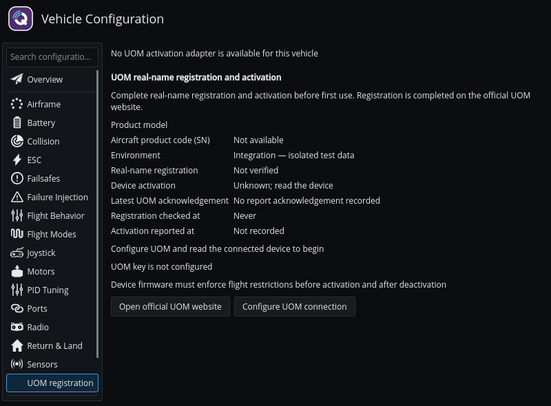
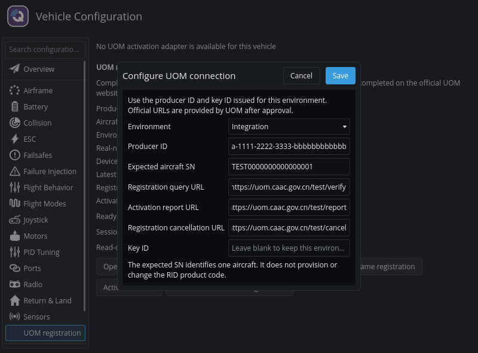
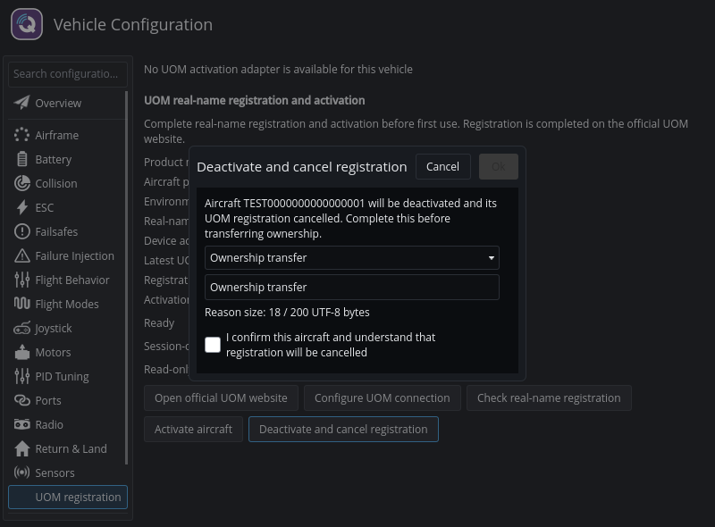

# UOM 实名登记与激活

QGroundControl 可直接连接民航局 UOM，完成实名登记状态核验、设备激活、激活状态上报，以及取消激活后的注销登记。
所有者在 [UOM 官方网站](https://uom.caac.gov.cn/)完成实名登记；QGroundControl 不收集身份证明，也不代做所有者身份认证。

本功能支持 **GB 46761—2025《民用无人驾驶航空器实名登记和激活要求》**中的方式 2 流程。
该强制性国家标准于 2025 年 10 月 31 日发布、2026 年 5 月 1 日实施，参见[官方标准信息](https://openstd.samr.gov.cn/bzgk/std/newGbInfo?hcno=495F3D69241E5961AFC4FA2939E383B4&refer=outter)和[民航局公布的标准正文](https://www.caac.gov.cn/XXGK/XXGK/BZGF/BZGF_GJBZ/202601/P020260120370062157303.pdf)。
支持该流程不代表取得整机认证或满足标准全部要求。

## 功能入口与支持范围

首版支持 Linux。
打开“载具配置 > UOM 登记”配置连接。
设备适配器可用时，工具栏显示独立的“UOM”指示器，分别显示登记、设备激活和平台回执状态；点击“管理登记”可进入同一页面。
只有载具固件插件提供 UOM 设备适配器时，才显示设备操作。
Linux 默认构建包含通用登记流程，但不包含设备适配器；操作 AMOV B950 需要启用可选 AMOV 适配器，并使用兼容的飞控和 RID 固件。



本页截图来自界面测试，使用合成的飞机身份与模拟流程数据，不是真实 UOM 回执。

产品唯一识别码（SN）由设备读取。
AMOV 协议不提供产品型号信息，因此型号栏显示通用设备标签。
此功能不烧录出厂身份、不修改 RID 参数，也不向 UOM 上报飞行数据。
Remote ID 运行识别信息播报是独立功能。

## 配置连接

1. 通过生产者获准的 UOM 接入流程，取得对应环境的生产者 ID、密钥 ID 和三个接口地址。
2. 连接飞机，打开 UOM 登记页面，点击“读取激活设备”。如果发现多个设备，明确选择要操作的设备。
3. 核对页面显示的产品码与目标飞机一致。
4. 打开“配置 UOM 连接”，选择“联调”或“正式”环境，填写生产者 ID、预期飞机 SN、三个接口地址和密钥 ID。
5. 保存后查看页面显示的凭据存储状态。



截图中的连接配置仅用于示例，实际操作时填写对应环境提供的接口地址和凭据。

预期 SN 仅用于核对身份，不会更改设备的产品码。
接口地址以 UOM 针对所选环境提供的信息为准，不能把联调地址当作正式地址。
不同环境和连接配置的凭据、核验结果及待处理操作相互隔离。
当前实现要求生产者 ID 为 36 个字符、产品码为 20 个不含空格的可打印 ASCII 字符，SM4 密钥为 32 位十六进制字符（输入密钥 ID 中的连字符会被去除）。
接口地址必须使用 `uom.caac.gov.cn` 的 HTTPS 地址，不能包含用户凭据、查询参数、片段或非标准端口。

密钥输入时隐藏显示，不写入普通设置或日志；保存时留空表示保留所选环境已保存的密钥。
Linux 优先使用系统 Secret Service 密钥环。
构建未包含密钥环支持或桌面会话无法访问密钥环时，页面明确提示仅在本次运行中保存凭据，重启 QGroundControl 后需重新输入。

## 核验与激活

页面分别显示三种结果：

| 结果 | 含义 |
| --- | --- |
| 实名登记状态 | 最近一次核验返回的正常、注销、无记录或未知状态。 |
| 设备激活状态 | 从当前设备实际读取的激活状态。 |
| 最近 UOM 确认 | 最近一次收到确认的激活状态上报结果，不是平台当前激活状态的查询结果。 |

1. 点击“打开 UOM 官方网站”，注册账号或登录，在官方页面完成目标飞机的实名登记。
2. 返回 QGroundControl，点击“核验实名登记状态”。
3. 确认飞机身份一致、登记状态正常。
4. 点击“激活飞机”，在确认对话框核对目标飞机后确认。

QGroundControl 仅在设备具备所需能力且状态已经确认后，才向 UOM 上报激活状态。
AMOV 适配器需要设备持久化确认和一致回读，通信应答本身不足以证明写入成功。
平台上报成功也不能单独证明固件已正确执行飞行限制。

## 取消激活与注销

转移所有权或退出使用前，完成以下流程：

1. 点击“取消激活并注销登记”。
2. 选择“退出使用”“所有权变更”或“其他原因”，填写原因。原因最多 200 个 UTF-8 字节，中文通常每字占 3 字节。
3. 核对目标飞机，勾选注销确认后提交。



QGroundControl 先确认设备未激活，再向 UOM 上报未激活状态，随后携带原因发起注销登记请求。
中途失败时保留待处理状态，全部步骤成功前不显示整项操作完成。
如果设备故障导致无法取消激活，按 UOM 流程在官方平台直接办理注销登记。

## 恢复中断的操作

发生断网、超时或重启后，重新连接同一架飞机，点击“重试待处理操作”。
确认对话框会说明待处理注销可能重新发送注销请求。
同参数请求至少间隔 60 秒，应用重启不会清除该间隔限制。

有待处理操作时，其环境和飞机身份锁定。
可以在“配置 UOM 连接”中修正生产者 ID、接口地址或密钥，并确认对待处理操作的修改提示。
保存修正不会自动写设备；继续操作时重新读取设备、核验登记，必要时取得新的注销令牌。

审计记录和恢复状态保存在 QGroundControl 应用数据目录的 `uom-registration.sqlite` 中。
审计记录包含飞机标识和操作信息，不包含密钥或注销令牌。
程序不会自动删除审计条目；为满足标准的一年留存要求，需要保留相应应用数据。

## 固件责任与验收

飞控和 RID 固件负责激活状态持久化，以及激活前和取消激活后的飞行限制。
QGroundControl 显示设备能够提供的检查结果，不自动修改解锁参数。
需要在实际飞机与固件组合上验证重启和固件更新后的状态保持、飞行限制及 UOM 回执。
软件测试和接口联调成功，不能单独证明整机符合性或标准规定的接口性能指标。

## 构建配置

先按[源码构建说明](../../qgc-dev-guide/getting_started/index.md)配置开发环境。
`QGC_UOM_REGISTRATION` 在 Linux 默认开启、其他平台默认关闭，首版开启该选项时要求 Linux。
该功能使用 OpenSSL Crypto、Qt Concurrent 和带 SQLite 驱动的 Qt SQL；Linux 安装包需要包含或声明对应运行库。
构建需要 OpenSSL 开发包；安装 libsecret 开发包可启用可选的系统密钥环支持。
制作安装包时需要包含 SQLite SQL 驱动。
视频支持遵循正常源码构建的依赖要求；如不需要视频流后端，可配置 `QGC_ENABLE_GST_VIDEOSTREAMING=OFF`，该选项不改变 UOM 流程。

使用标准调试预设启用 AMOV 适配器：

```bash
uv run --frozen --project tools --group build python tools/configure.py --preset default -- \
  -DQGC_UOM_REGISTRATION=ON -DQGC_UOM_AMOV_ADAPTER=ON
just build
```

`QGC_UOM_AMOV_ADAPTER` 默认关闭，开启时要求 `QGC_UOM_REGISTRATION=ON`。
仅启用 AMOV 适配器时才生成其激活控制与状态消息所需的私有 MAVLink 扩展。
关闭适配器时保留默认 MAVLink 方言；如需完全移除本功能，将两个选项均设为 `OFF`。

其他设备通过 `FirmwarePlugin::createUomDeviceAdapter(...)` 提供 `UomDeviceAdapter`。
每架飞机独立持有适配器，通用登记流程不依赖 AMOV 或完整 RID 设备管理模块。
